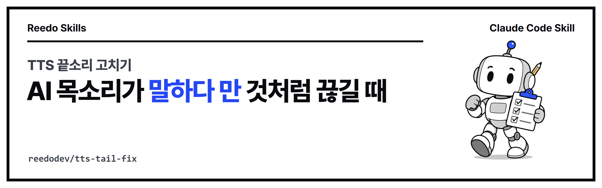

<p align="center"></p>

<p align="center">
<a href="https://github.com/reedodev/tts-tail-fix/actions/workflows/test.yml"></a>


</p>

# TTS 끝소리 고치기 (tts-tail-fix)

보이스 클론 TTS의 마지막 음절이 뚝 끊기는 문제를 찾아내고, 문장 끝에 버리는 단어를 붙여 합성한 뒤 쉼에서 자르는 방법과 실제 소리 끝의 페이드로 고칩니다. 효과가 없었던 방법도 함께 적었습니다.

## 처음 쓰시는 분을 위한 안내

### 이 스킬은 언제 쓰나요?

- AI로 내 목소리나 나레이션을 만들었는데 문장 끝소리가 뚝 끊겨서 말하다 만 것처럼 들릴 때
- 영상에 들어갈 음성 파일이 수십 개라서, 어느 파일이 끊겼는지 귀로 하나씩 찾기 힘들 때

이 스킬은 음성 파일의 끝이 얼마나 빨리 작아지는지 재서 끊긴 파일을 골라내고, 고치는 방법까지 알려 줍니다. 사람의 말은 끝에서 0.1초 이상 서서히 작아지는데, 끊긴 소리는 0.05초 안에 사라집니다. 이 차이를 숫자로 확인합니다.

### 용어 풀이

| 용어 | 뜻 |
|---|---|
| Claude Code | 터미널에서 AI와 대화하며 파일 작업을 시키는 프로그램입니다. |
| 스킬(skill) | Claude Code에게 "이 일은 이렇게 하라"고 알려 주는 설명서와 도구 묶음입니다. |
| 터미널 | 글자로 명령을 입력하는 창입니다. Windows는 PowerShell, Mac은 터미널 앱입니다. |
| TTS | 글을 읽어 소리로 만들어 주는 AI(Text-to-Speech)입니다. |
| 센티널 | 문장 끝에 일부러 붙이는 버릴 단어입니다. 이 단어가 대신 끊기게 하고 뒤에서 잘라 냅니다. |
| 디케이(decay) | 소리가 끝에서 작아지는 데 걸리는 시간입니다. 단위는 ms(1,000분의 1초)입니다. |

### 준비 확인

```bash
node -v          # v18 이상이면 됩니다. 없으면 https://nodejs.org 에서 설치합니다.
python --version # 3.10 이상
```

- **Windows**: `python --version`이 안 되면 https://www.python.org/downloads/ 에서 설치하고 "Add python.exe to PATH"를 체크합니다.
- **Mac**: `python3 --version`으로 확인하고, 없으면 python.org에서 설치합니다. 아래 명령의 `python`은 `python3`, `pip`는 `pip3`로 바꿉니다.

이 스킬이 쓰는 파이썬 도구 두 가지를 설치하고 확인합니다.

```bash
pip install numpy soundfile
pip show numpy soundfile       # 두 패키지의 Name, Version이 나오면 설치된 것입니다.
```

### 따라 하기 3단계

**1단계. 설치합니다.** Claude Code에서 입력합니다.

```
/plugin marketplace add reedodev/tts-tail-fix
/plugin install tts-tail-fix@tts-tail-fix
```

**2단계. 에이전트에게 이렇게 말합니다.** 파일 이름만 내 것으로 바꿔서 복사해 씁니다.

1. `narration.wav 끝소리가 끊겼는지 tts-tail-fix로 검사해 줘.`
2. `끊긴 파일은 끝에 짧은 말을 붙여서 다시 합성한 뒤 쉼에서 잘라 줘. 쉼이 안 찾아지면 다른 시드로 다시 합성해 줘.`
3. `고친 파일을 다시 검사해서 OK가 나오는지 알려 주고, 마지막 단어가 제대로 들리는지 받아쓰기로도 확인해 줘.`

**3단계. 결과를 확인합니다.** 검사 결과가 `OK`이면 소리가 서서히 줄어든 것입니다. 그래도 마지막 음절이 제대로 발음됐는지는 검사로 알 수 없으니, 꼭 한 번은 귀로 들어 봅니다.

### 직접 실행해 보기

내 음성 파일이 없어도 연습용 소리로 먼저 해 볼 수 있습니다. 아래 첫 줄은 사람 목소리가 아닌 잡음으로 만든 짧은 연습 파일 두 개(`practice/chopped.wav`, `practice/sentinel.wav`)를 만듭니다. 이 저장소를 새로 받아 실제로 실행한 결과입니다.

```bash
python skills/tts-tail-fix/examples/make-samples.py practice
python skills/tts-tail-fix/scripts/tts_tail.py check practice/chopped.wav
python skills/tts-tail-fix/scripts/tts_tail.py finish practice/chopped.wav practice/chopped-fixed.wav
python skills/tts-tail-fix/scripts/tts_tail.py cut practice/sentinel.wav practice/sentinel-clean.wav
python skills/tts-tail-fix/scripts/tts_tail.py check practice/chopped-fixed.wav practice/sentinel-clean.wav
```

```
wrote practice/chopped.wav and practice/sentinel.wav
CHOPPED practice/chopped.wav  speech -26.3 dB  decay 10 ms
FINISHED practice/chopped.wav -> practice/chopped-fixed.wav (1.97s)
CUT practice/sentinel.wav at 1.66s -> practice/sentinel-clean.wav (1.97s)
OK      practice/chopped-fixed.wav  speech -26.3 dB  decay 100 ms
OK      practice/sentinel-clean.wav  speech -26.4 dB  decay 100 ms
```

읽는 법은 이렇습니다. `CHOPPED ... decay 10 ms`는 소리가 10ms 만에 사라졌다는 뜻으로, 기준 70ms보다 짧아 끊긴 것으로 봅니다. 고친 뒤에는 `OK ... decay 100 ms`가 나옵니다. `finish`는 소리가 실제로 끝나는 곳에 부드러운 페이드(서서히 작아짐)를 넣고, `cut`은 센티널 앞의 쉼에서 잘라 냅니다. 끊긴 파일이 하나라도 있으면 종료 코드가 1, 모두 OK이면 0입니다.

### 막힐 때

| 증상 | 원인 | 해결 |
|---|---|---|
| `numpy and soundfile are required. Run: pip install numpy soundfile` | 파이썬 도구가 설치되지 않았습니다. | `pip install numpy soundfile`(Mac은 `pip3`)을 실행합니다. |
| `Error: audio file not found: narration.wav` (종료 코드 2) | 파일 이름이나 폴더가 다릅니다. | 현재 터미널 위치에서 파일이 보이는지 확인하고 경로를 맞춥니다. |
| `NO_PAUSE ... (re-synthesize with another seed, or use finish)` (종료 코드 3) | `cut`은 센티널 앞에 0.2초 이상의 쉼이 있어야 하는데 찾지 못했습니다. | 다른 시드로 다시 합성하거나, 센티널 없이 `finish`를 씁니다. 숨소리가 커서 못 찾으면 `--silence-db -45`를 붙여 봅니다. |
| 사용법 설명이 나오고 끝납니다(종료 코드 2). | 명령 이름이나 파일 개수가 맞지 않습니다. | `check 파일...`, `cut 입력 출력`, `finish 입력 출력` 형식인지 확인합니다. |
| 고친 뒤 `OK`가 나와도 여전히 끊긴 것처럼 들립니다. | 검사는 소리가 줄어드는 속도만 잽니다. 마지막 음절이 발음됐는지는 모릅니다. | 귀로 듣고, 받아쓰기(음성 인식)로 마지막 단어를 확인합니다. |

<!-- prereq-adapt -->
## 무엇이 필요한가요?

꼭 필요한 것은 Python 3.10 이상과 `pip install numpy soundfile`, TTS로 만든 음성 파일(wav, flac)입니다. 권장·선택 준비물까지 정리한 표는 [SKILL.md의 준비물](skills/tts-tail-fix/SKILL.md#준비물-쓰기-전에-있어야-하는-것)에 있습니다.

## 바꿔 쓰기

에이전트에게 다음처럼 말하면 옵션을 바꿔서 실행합니다.

- "영어 음성이야" → 센티널을 ` okay.`처럼 그 언어의 짧은 말로 바꿉니다. 나머지 절차는 같습니다
- "숨소리가 커서 쉼을 못 찾아" → `--silence-db -45` (조용하다고 볼 기준을 올립니다)
- "쉼이 짧은 목소리야" → `--min-pause 0.15`

말과 옵션의 대응표는 [SKILL.md의 바꿔 쓰기](skills/tts-tail-fix/SKILL.md#바꿔-쓰기-이렇게-말하세요)에 있습니다.

## 설치

**Claude Code 플러그인으로 설치**

```
/plugin marketplace add reedodev/tts-tail-fix
/plugin install tts-tail-fix@tts-tail-fix
```

**폴더만 복사**

```bash
git clone https://github.com/reedodev/tts-tail-fix.git
cp -r tts-tail-fix/skills/tts-tail-fix ~/.claude/skills/
```

필요한 것: Python 3.10+, numpy, soundfile

## 바로 해 보기

위 "직접 실행해 보기"의 명령 5줄이 가장 빠른 방법입니다. 내 음성 파일이 있으면 아래처럼 바로 검사합니다.

```bash
pip install numpy soundfile
python skills/tts-tail-fix/scripts/tts_tail.py check 내파일.wav
```n
자세한 절차, 옵션, 한계는 [SKILL.md](skills/tts-tail-fix/SKILL.md)에 있습니다. 에이전트가 이 파일을 읽고 그대로 따릅니다.

## 시험

`node tests/run.mjs`가 SKILL.md 형식을 검사하고 예시 파일로 스크립트를 실제로 실행합니다. 푸시할 때마다 GitHub Actions가 같은 시험을 돌립니다(위 test 배지).

<!-- credits -->
## 출처와 영감

- **문제를 발견한 곳**: 작성자가 [Qwen3-TTS](https://github.com/QwenLM/Qwen3-TTS)(Alibaba Qwen 팀)로 만든 본인 목소리 음성에서 측정했습니다. 다른 TTS에서도 같은 증상이 나타날 수 있지만 모두 확인한 것은 아닙니다.
- **마지막 단어 확인**: 받아쓰기는 [openai/whisper](https://github.com/openai/whisper) 같은 음성 인식 도구를 씁니다.
- 버리는 단어(센티널)를 붙여 쉼에서 자르는 방법과 검사 스크립트는 작성자가 직접 시험하며 만든 것입니다.

## 만든 사람

**리도**, AI 좌충우돌 실습 중인 20년차 엔지니어입니다. 매일 AI에게 일을 맡기다가 막힌 부분을 고쳐 가며 이 스킬을 만들었습니다.
[YouTube @Reedodev](https://www.youtube.com/@Reedodev) · [Threads @reedo.dev](https://www.threads.com/@reedo.dev) · [GitHub @reedodev](https://github.com/reedodev)

같이 만든 다른 스킬: [설명 영상 만들기](https://github.com/reedodev/explainer-studio) · [옵시디언 3D 지식그래프](https://github.com/reedodev/obsidian-brain-3d) · [노트 먼저 찾아보기](https://github.com/reedodev/vault-recall) · [작업 기록 강의자료](https://github.com/reedodev/work-to-lecture-deck) · [한국어 말투 점검](https://github.com/reedodev/korean-tone-check) · [네이버 황금키워드](https://github.com/reedodev/naver-golden-keywords) · [한글 양식 채우기](https://github.com/reedodev/hwpx-form-fill) · [카드뉴스 렌더](https://github.com/reedodev/html-card-render) · [영상 비율 검사](https://github.com/reedodev/social-video-gate) · [유튜브 게시 점검](https://github.com/reedodev/youtube-publish-checklist)

---

## English

Finds TTS clips whose last syllable is chopped off, then fixes them by synthesizing a throw-away word after the sentence, cutting at the pause, and fading out where the sound really ends. The methods that did not work are documented too.

### New here? A beginner's guide

**When to use it.** Your AI-made narration ends abruptly, as if the speaker stopped mid-word. Or you have dozens of voice files and cannot listen to each one to find the broken ones. The skill measures how fast the level drops at the end of each file. Natural speech fades over 100 ms or more; a chopped ending vanishes in well under 50 ms. You get a number instead of a guess.

**Glossary**

| Term | Meaning |
|---|---|
| Claude Code | A program you talk to in the terminal; it works on your files for you. |
| Skill | A bundle of instructions and tools that tells Claude Code how to do one kind of job. |
| Terminal | The window where you type commands (PowerShell on Windows, Terminal on Mac). |
| TTS | Text-to-speech: AI that reads text aloud. |
| Sentinel | A throw-away word you add after the sentence. It gets chopped instead of your real last word, and you cut it off afterwards. |
| Decay | How long the sound takes to fade at the end, in ms (thousandths of a second). |

**Check your setup**

```bash
node -v          # v18 or newer. If missing, install from https://nodejs.org
python --version # 3.10 or newer
```

- **Windows**: if `python --version` fails, install Python from https://www.python.org/downloads/ and tick "Add python.exe to PATH".
- **Mac**: use `python3 --version`; install from python.org if missing. Use `python3` and `pip3` in the commands below.

Install and check the two Python packages the skill uses:

```bash
pip install numpy soundfile
pip show numpy soundfile       # both should print a Name and Version
```

**Three steps**

1. Install in Claude Code:
   ```
   /plugin marketplace add reedodev/tts-tail-fix
   /plugin install tts-tail-fix@tts-tail-fix
   ```
2. Tell the agent (copy these, change the file name):
   - `Check narration.wav for a chopped ending with tts-tail-fix.`
   - `For chopped files, re-synthesize with a short extra word after the sentence and cut at the pause. If no pause is found, re-synthesize with another seed.`
   - `Re-check the fixed file and tell me if it says OK, and also transcribe it to confirm the last word is there.`
3. Look at the result. `OK` means the sound fades out gradually. The check cannot tell whether the last syllable was pronounced in full, so listen to it at least once.

**Try it without your own audio.** The first line below makes two short practice clips from noise (not a human voice): `practice/chopped.wav` and `practice/sentinel.wav`. This is real output from a fresh clone:

```bash
python skills/tts-tail-fix/examples/make-samples.py practice
python skills/tts-tail-fix/scripts/tts_tail.py check practice/chopped.wav
python skills/tts-tail-fix/scripts/tts_tail.py finish practice/chopped.wav practice/chopped-fixed.wav
python skills/tts-tail-fix/scripts/tts_tail.py cut practice/sentinel.wav practice/sentinel-clean.wav
python skills/tts-tail-fix/scripts/tts_tail.py check practice/chopped-fixed.wav practice/sentinel-clean.wav
```

```
wrote practice/chopped.wav and practice/sentinel.wav
CHOPPED practice/chopped.wav  speech -26.3 dB  decay 10 ms
FINISHED practice/chopped.wav -> practice/chopped-fixed.wav (1.97s)
CUT practice/sentinel.wav at 1.66s -> practice/sentinel-clean.wav (1.97s)
OK      practice/chopped-fixed.wav  speech -26.3 dB  decay 100 ms
OK      practice/sentinel-clean.wav  speech -26.4 dB  decay 100 ms
```

How to read it: `CHOPPED ... decay 10 ms` means the sound vanished in 10 ms, shorter than the 70 ms threshold, so it counts as chopped. After fixing you get `OK ... decay 100 ms`. `finish` adds a soft fade where the sound really ends; `cut` cuts at the pause before the sentinel. The exit code is 1 if any file is chopped and 0 if all are OK.

**Troubleshooting**

| Symptom | Cause | Fix |
|---|---|---|
| `numpy and soundfile are required. Run: pip install numpy soundfile` | The Python packages are missing. | Run `pip install numpy soundfile` (`pip3` on Mac). |
| `Error: audio file not found: narration.wav` (exit code 2) | Wrong file name or folder. | Make sure the file is visible from your current terminal folder and fix the path. |
| `NO_PAUSE ... (re-synthesize with another seed, or use finish)` (exit code 3) | `cut` needs a pause of 0.2 s or more before the sentinel and found none. | Re-synthesize with another seed, or use `finish` without a sentinel. If breath noise hides the pause, add `--silence-db -45`. |
| The usage text appears and nothing runs (exit code 2) | Unknown command or wrong number of files. | Use `check file...`, `cut in out` or `finish in out`. |
| It says `OK` after fixing but the ending still sounds cut | The check only measures how fast the level drops, not whether the syllable was pronounced. | Listen to it, and transcribe it with speech recognition to confirm the last word. |

Install: `/plugin marketplace add reedodev/tts-tail-fix` then `/plugin install tts-tail-fix@tts-tail-fix`, or copy `skills/tts-tail-fix` into `~/.claude/skills/`. See [SKILL.md](skills/tts-tail-fix/SKILL.md) for the full procedure.

**Credits.**
- Measured on voice-clone speech made with [Qwen3-TTS](https://github.com/QwenLM/Qwen3-TTS) by its author; other TTS models may show the same symptom, which has not been checked for all. Last-word checks use speech recognition such as [openai/whisper](https://github.com/openai/whisper). The sentinel-and-cut method and the check script were written by the author while testing.

MIT License; third-party models, fonts and libraries keep their own licenses.
